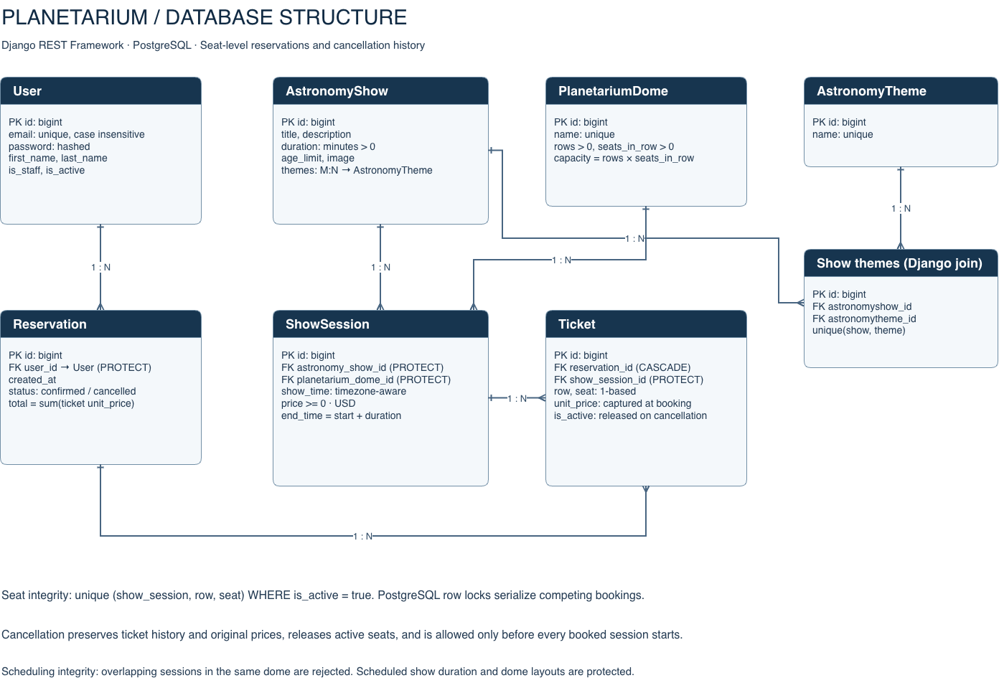
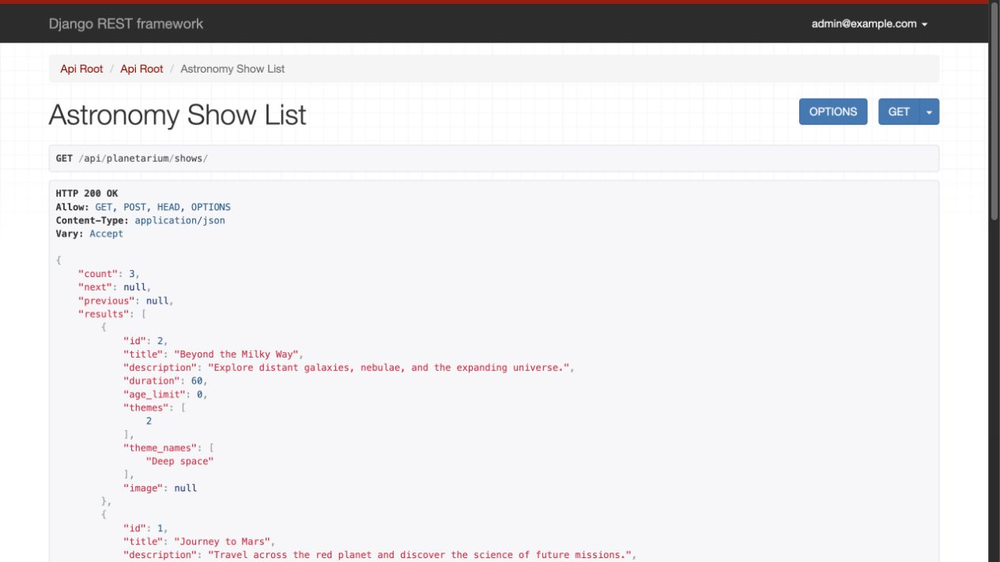
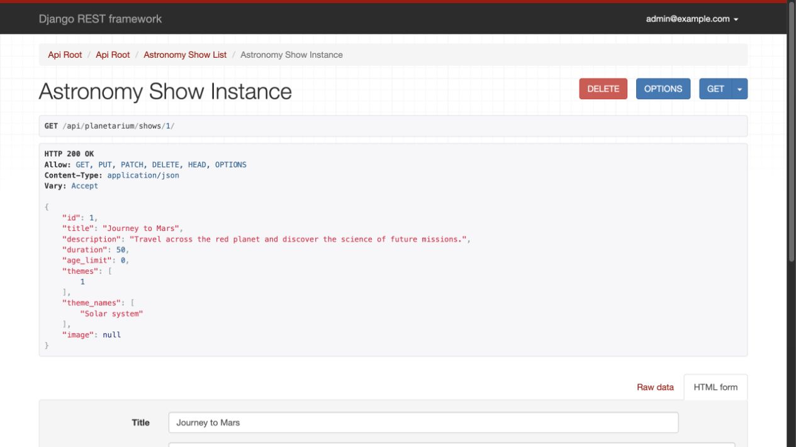
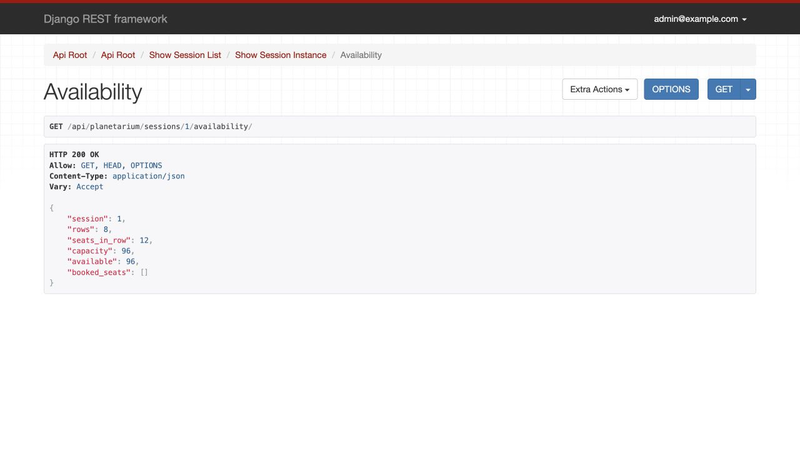

# Planetarium API

A Django REST Framework portfolio project for exploring astronomy shows and reserving seats in planetarium domes. This implements **one project option: Planetarium API**.

## Features

- Email registration, JWT access/refresh tokens, refresh rotation and logout.
- Personal account management and authenticated Browsable API access.
- Astronomy themes, shows with optional posters, domes and scheduled sessions.
- Search shows by title/theme and sessions by date, show, dome or upcoming status.
- Live seat availability without exposing customer information.
- Atomic multi-seat reservations, captured ticket prices and private booking history.
- Owner-only cancellation that releases seats while preserving booking history.
- Staff-only catalogue management, Django admin and OpenAPI/Swagger documentation.
- PostgreSQL row locks and a database uniqueness constraint prevent double booking.
- Docker Compose, persistent database/media/static volumes, demo fixtures and CI.

Additional business logic prevents overlapping sessions, past bookings, out-of-range seats, changes to scheduled dome layouts/show durations, and rescheduling or repricing booked sessions. Cancellation is unavailable once any session in a reservation has started. All dates use UTC; ticket prices are USD. This is a reservation system, without payment processing.

## Run locally

Use Python 3.11 or later (CI uses 3.11):

```sh
git clone -b develop https://github.com/sydneyhart/planetarium-api.git
cd planetarium-api
python -m venv .venv
source .venv/bin/activate
# Windows: .venv\Scripts\activate
pip install -r requirements-dev.txt
cp .env.sample .env
```

Edit `.env`: replace `SECRET_KEY` with a long random value and choose a local database password. Never commit `.env`. SQLite is used locally unless `POSTGRES_HOST` is set. To use PostgreSQL, configure `POSTGRES_HOST`, `POSTGRES_DB`, `POSTGRES_USER`, and `POSTGRES_PASSWORD` for an existing server.

```sh
python manage.py migrate
python manage.py createsuperuser
python manage.py seed_demo  # optional: sample shows and future sessions
python manage.py runserver
```

Open [API root](http://127.0.0.1:8000/api/), [Swagger documentation](http://127.0.0.1:8000/api/docs/), or [Django admin](http://127.0.0.1:8000/admin/).

For a disposable demo, `python manage.py seed_demo --with-users` creates `admin@example.com` (staff) and `visitor@example.com` (customer), both with password `Planetarium-demo-2026!`. These publicly documented credentials are opt-in and must only be used locally. Re-running the command does not reset existing account passwords.

## Run with Docker

Install Docker with Compose, clone the `develop` branch, copy `.env.sample` to `.env`, and edit its secrets as above.

```sh
docker compose up --build -d
docker compose exec app python manage.py createsuperuser
docker compose exec app python manage.py seed_demo
# Or create disposable demo accounts:
# docker compose exec app python manage.py seed_demo --with-users
docker compose logs -f app
```

The API is at `http://127.0.0.1:8000/`. The slim image runs as a non-root user. Startup waits for database connectivity, applies migrations and collects static files. PostgreSQL is internal to Compose. Named volumes retain the database, uploaded media and collected static files across container recreation.

```sh
docker compose down       # stop; retain data
docker compose up -d      # restart with retained data
# docker compose down -v  # destructive reset: removes all project volumes
```

This Compose setup uses Django's development server and `DEBUG=1` for local media/static serving. A public deployment needs a production WSGI/ASGI server, `DEBUG=0`, HTTPS, restricted hosts and dedicated static/media serving; it must not use the demo accounts.

## Authentication and browsing

Register a customer:

```sh
curl -X POST http://127.0.0.1:8000/api/user/register/ \
  -H 'Content-Type: application/json' \
  -d '{"email":"reader@example.com","password":"A-long-unique-password-2026!","first_name":"Alex"}'
```

The response contains the public account fields, never the password. Obtain tokens:

```sh
curl -X POST http://127.0.0.1:8000/api/user/token/ \
  -H 'Content-Type: application/json' \
  -d '{"email":"reader@example.com","password":"A-long-unique-password-2026!"}'
```

Response: `{"refresh":"<refresh token>","access":"<access token>"}`. Use the access token as `Authorization: Bearer <access token>` on API requests. Access tokens expire after 15 minutes. `POST /api/user/token/refresh/` with `{"refresh":"<refresh token>"}` returns a new pair and blacklists the old refresh token. `POST /api/user/logout/` with the current refresh token blacklists it; an already issued access token remains valid until expiry.

For HTML pages, log in with email/password at [Browsable API login](http://127.0.0.1:8000/api-auth/login/). Session authentication supports the interactive forms. Customers can browse and reserve; staff also see catalogue editing forms. On reservation creation, select **Raw data**, choose `application/json`, and enter the nested ticket payload below. Admin access requires a staff account.

## Endpoints

All paths below start with `/api/`. Catalogue reads and reservations require authentication; only registration/token endpoints and documentation are public. Catalogue writes require staff status. Account changes affect the signed-in user only; reservations are visible only to their owner, including for staff API users.

| Path | Methods | Purpose |
| --- | --- | --- |
| `user/register/` | POST | Register an email account |
| `user/token/` | POST | Obtain JWT pair |
| `user/token/refresh/` | POST | Rotate refresh token |
| `user/logout/` | POST | Blacklist refresh token |
| `user/me/` | GET, PUT, PATCH | Read/update own account and password |
| `planetarium/themes/` | GET, POST | List/create themes |
| `planetarium/shows/` | GET, POST | List/create astronomy shows |
| `planetarium/domes/` | GET, POST | List/create domes |
| `planetarium/sessions/` | GET, POST | List/create scheduled sessions |
| `planetarium/{themes,shows,domes,sessions}/{id}/` | GET, PUT, PATCH, DELETE | Catalogue detail; writes staff-only |
| `planetarium/sessions/{id}/availability/` | GET | Seat map and availability |
| `planetarium/reservations/` | GET, POST | Own history / create reservation |
| `planetarium/reservations/{id}/` | GET | Own reservation detail |
| `planetarium/reservations/{id}/cancel/` | POST | Cancel own reservation |
| `docs/`, `schema/` | GET | Swagger UI and OpenAPI schema |

List responses are paginated with `count`, `next`, `previous`, and `results` (20 per page). Examples:

```text
/api/planetarium/shows/?title=mars&theme=1
/api/planetarium/sessions/?date=2026-12-20&show=1&dome=1&upcoming=true
```

Create a reservation using valid future session IDs; row and seat numbers start at **1**, with at most 20 tickets per request:

```sh
curl -X POST http://127.0.0.1:8000/api/planetarium/reservations/ \
  -H 'Authorization: Bearer <access token>' \
  -H 'Content-Type: application/json' \
  -d '{"tickets":[{"show_session":1,"row":1,"seat":2}]}'
```

A successful response is HTTP 201 and includes the reservation ID, `confirmed` status, tickets with captured unit prices, and a total. All requested seats are booked together or none are booked. Duplicate, occupied, out-of-range or past-session seats return HTTP 400. Another customer's reservation returns HTTP 404.

Availability response example:

```json
{"session":1,"rows":8,"seats_in_row":12,"capacity":96,"available":95,"booked_seats":[{"row":1,"seat":2}]}
```

Cancel with `POST /api/planetarium/reservations/1/cancel/` and your bearer token. Repeated cancellation is safe. Historical tickets remain attached with inactive status; the seats become available again.

For a show poster, staff can send multipart form data with an `image` file to `PATCH /api/planetarium/shows/{id}/` or use the Browsable API upload form. Uploaded files are served under `/media/` locally. Invalid images are rejected.

## Database design



[Edit the draw.io diagram](docs/database.drawio) in [diagrams.net](https://app.diagrams.net/). The diagram includes the explicit show/theme join table. JWT blacklist tables maintained by SimpleJWT are omitted for clarity.

Users own reservations; reservations contain tickets; tickets reference scheduled shows in domes. Active seat uniqueness is enforced in the database. Cancelled tickets retain prices and history but no longer occupy seats. PostgreSQL row locks serialize competing bookings and schedule changes.

## Browsable API screenshots

These are actual captures of the seeded local application (using port 8020 during documentation capture).





## Validation

```sh
python manage.py test --settings=config.test_settings
python manage.py makemigrations --check --dry-run
python manage.py spectacular --file /tmp/planetarium-schema.yml --validate --fail-on-warn
ruff check .
ruff format --check .
python -m pip check
```

There are **37 tests**: SQLite passes 36 and skips the PostgreSQL-specific concurrent booking test; PostgreSQL passes all 37. Coverage includes account security, permissions, booking atomicity, concurrent seat contention, schedule conflicts, cancellation, filtering, uploads and database constraints.

To run the full suite in Docker, install development tools in the image:

```sh
INSTALL_DEV=true docker compose build app
docker compose run --rm app python manage.py test --settings=config.test_settings
```

GitHub Actions runs both SQLite and Docker/PostgreSQL tests, migration/schema/style/dependency checks, a non-root check, and HTTP booking/static-file smoke tests. It recreates the containers and verifies that reservations persist. Test settings use a fast password hasher only for tests.
